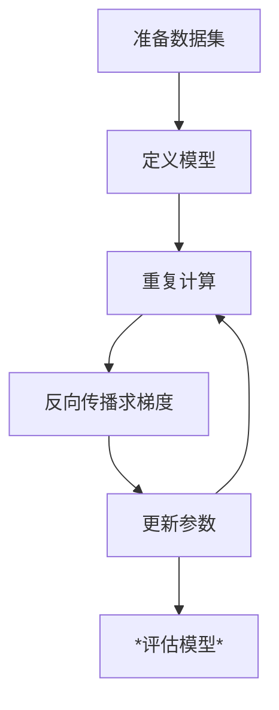

**总是忘事，写个悟道列表，记录一下**
**~~顺便警示一下自己~~**

# 2026/9/11
# 写栈实现二叉树遍历悟道

>悟道：
    先序 = 不管处理，看到就输出，输出完处理子树
    中序 = 处理完左子树就输出，再处理右子树
    后序 = 处理完左右子树再输出

-----

# 2026/9/11
# 写快排

>悟：
    快排的大while循环，要右到左处理完一边，再跳另一边

------

# 2026/9/11
# 写归并，和无递归归并排序（倍增法）

>悟道：
    递归比较像自顶向下，非递归则是自底向上
    **之后写代码的时候注意区间的<u>左闭右开</u>性**
    `[l, r)`

# 2026/9/12 
# 看了看lambda && std::bind

> XX:
> 只要一个东西可以用 `( )` 调用，它就可以参与很多 STL 算法和泛型代码。
> > **It's callable!!!**

# 2026/9/25 
# 每次换设备一定要上传github

# 2026/9/26 
# 深度学习？！难难！？

> 线性回归 = 用一个随意的值算误差，用误差算对每个特征的权重，然后乘以学习率后更新 'W' and 'b'
> 对于同一个数据集可以复用多次（多个epoch），但是训练次数不是越多越好

# 2026/9/26 
# 已！悟！
 
> 三要素 = 神经网络 net + 损失函数 Loss + 优化算法（梯度下降 -> sgd）
> 最后再epoch的循环训练中反向传播，迭代权重W和偏移b

# 为什么神经网络，的权重参数要设置为正态分布的随机取值

# 2026/10/05
> 运算符重载一定要考虑自赋值的情况，本质要先理清工作顺序

# 2026/10/9
> 训练模型的步骤：

# 2026/10/13
> train_iter, **net**, **loss**, loss.backward(), **updater(optimizer)**, test for accuracy

# 2026/10/29
> 又好久没写......
> 没啥悟道的，记录一下学习到CNN
> 把之前的旧手机root了，数据消失了，我的一部分消失了，回不去了。。。